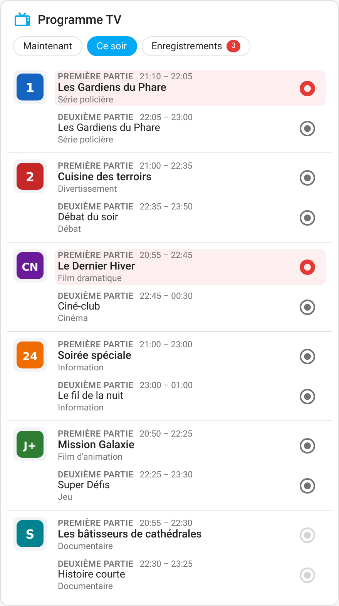
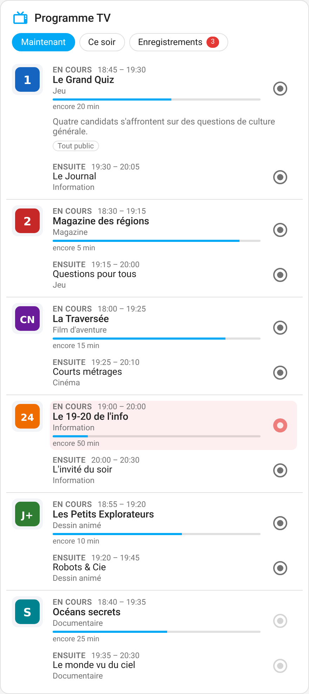
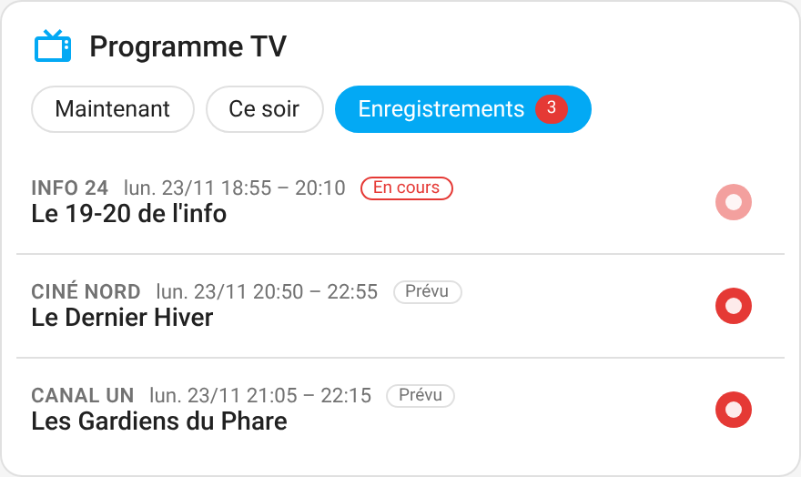
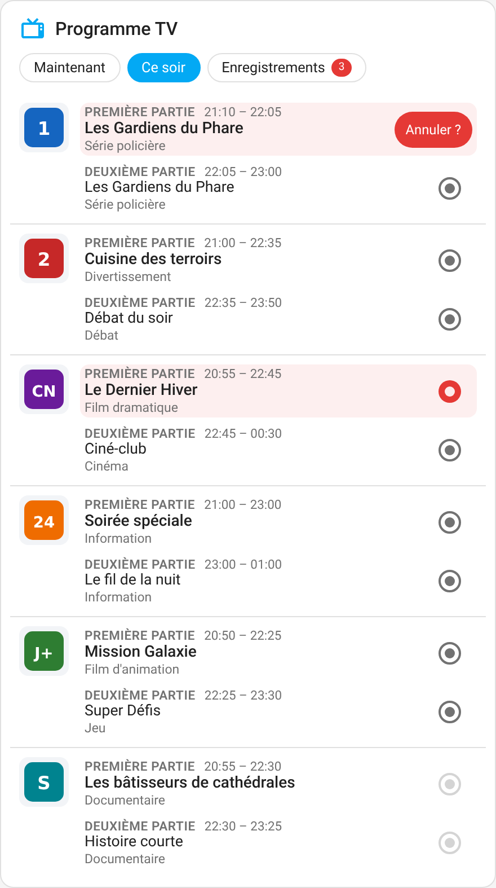
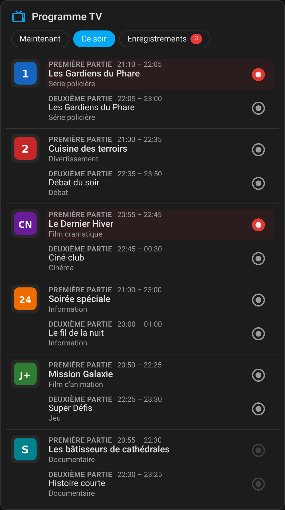
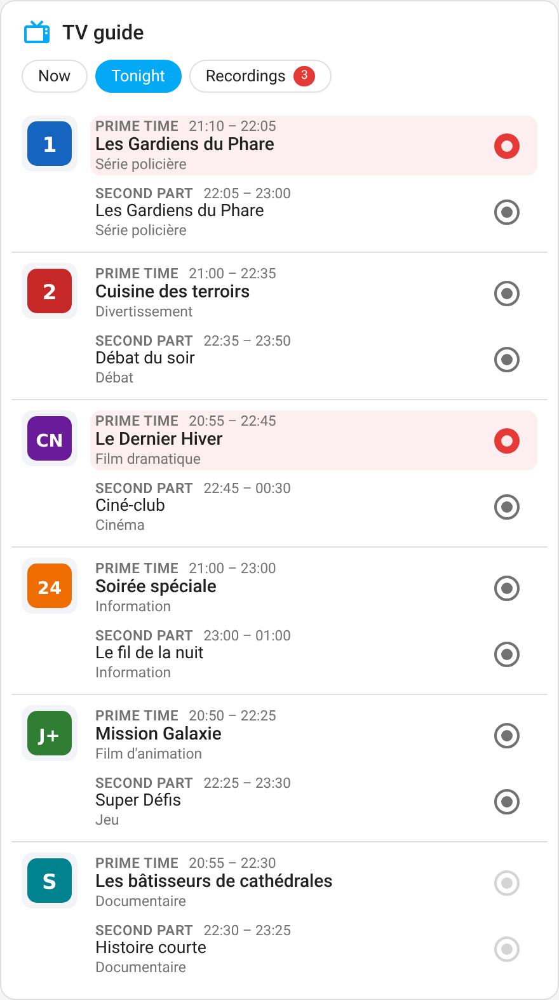
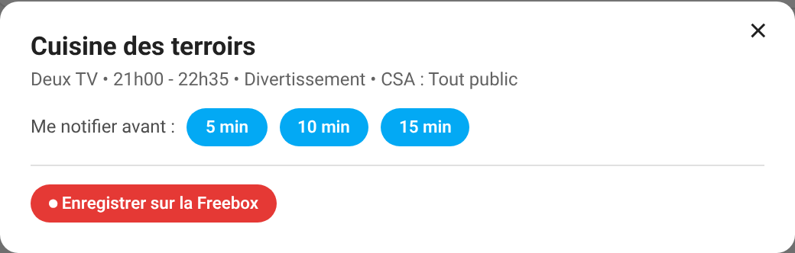
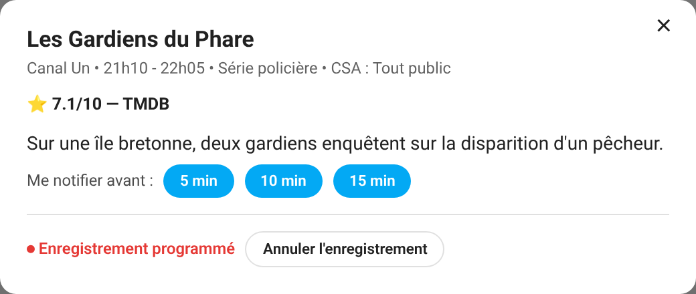
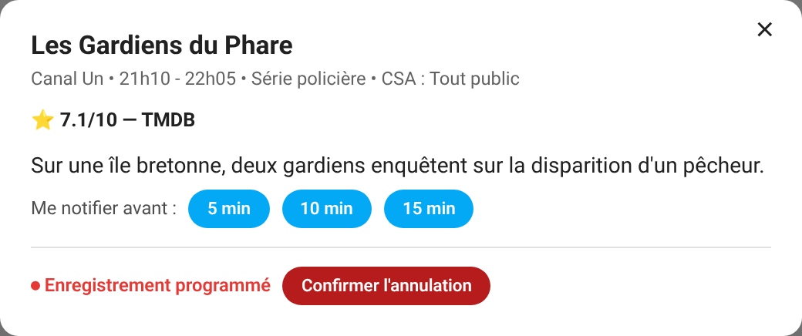
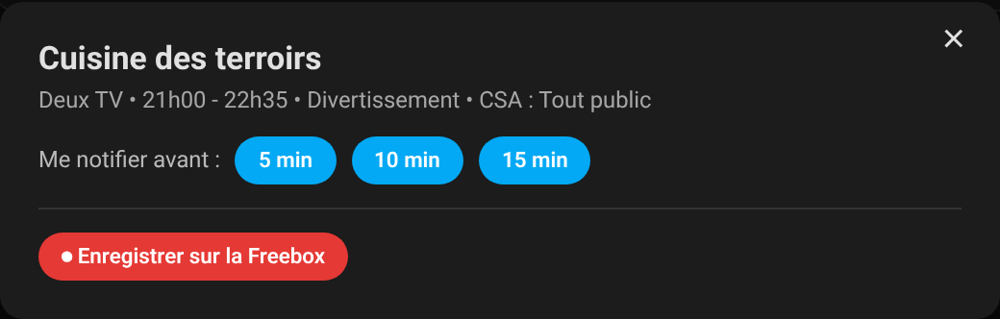

# Freebox PVR


🇫🇷 [Français](#français) · 🇬🇧 [English](#english)

[](https://github.com/akoonet-homeassistant/freebox_pvr/releases)
[](LICENSE)
[](https://hacs.xyz)



## Français

Freebox PVR programme des **enregistrements TV sur votre Freebox** (Revolution, Mini 4K, Delta, Pop, Ultra) depuis Home Assistant. Il s'appuie sur le guide [Programme TNT FR](https://github.com/cyclope205/programme-tnt-fr) : vous choisissez une chaîne et un programme, Freebox PVR retrouve la chaîne côté Freebox et programme l'enregistrement sur le disque du Freebox Server.

> L'API d'enregistrement (PVR) de Freebox OS est indiquée comme « instable » par Free : elle peut changer sans préavis.

### Fonctionnalités

- **Enregistrer depuis le guide** : le programme en cours, le suivant, la première ou la deuxième partie de soirée d'un capteur Programme TNT FR, en un seul appel.
- **Enregistrer à la main** : chaîne, titre, sous-titre, début et fin.
- **Recherche de la chaîne** à partir du nom du guide (accents, « + », « HD »… gérés), avec des **correspondances manuelles** si besoin.
- **Marges** avant et après réglables, **qualité** au choix (automatique, HD, SD, basse définition), modifiables pour chaque enregistrement.
- **Pas de doublon** : un 2e appel pour le même programme renvoie l'enregistrement existant.
- **Programme déjà commencé** : l'enregistrement démarre tout de suite.
- **Annulation** d'un enregistrement, par identifiant ou par programme.
- **Entités** : enregistrements programmés (avec leur liste), prochain enregistrement, enregistrement en cours.
- **Bouton dans la carte Programme TNT FR** : la fiche de chaque programme (carrousels, Guide TV, Top films) propose « ⏺ Enregistrer sur la Freebox », ou indique que le programme est déjà enregistré avec un bouton pour l'annuler. Rien à configurer.
- **Carte du tableau de bord** « Freebox PVR » : le programme TV (maintenant, ce soir) avec un bouton d'enregistrement sur chaque programme, et la liste des enregistrements. Aucune ressource à ajouter.
- **Interface en français et en anglais**, selon la langue de l'utilisateur.

### Installation

#### Par HACS (dépôt personnalisé)

[](https://my.home-assistant.io/redirect/hacs_repository/?owner=akoonet-homeassistant&repository=freebox_pvr&category=integration)

1. Dans HACS, ajoutez `https://github.com/akoonet-homeassistant/freebox_pvr` comme dépôt personnalisé (catégorie *Intégration*), ou utilisez le bouton ci-dessus.
2. Installez **Freebox PVR**, puis redémarrez Home Assistant.
3. *Paramètres → Appareils et services → Ajouter une intégration* → **Freebox PVR**.

#### Manuelle

Copiez `custom_components/freebox_pvr` dans le dossier `custom_components` de votre configuration, redémarrez, puis ajoutez l'intégration.

### Configuration

1. Indiquez l'adresse de la Freebox. Pour la première configuration, utilisez l'adresse locale `mafreebox.freebox.fr` (port 443) : une nouvelle application ne peut être autorisée que depuis le réseau local.
2. Cliquez sur **Valider**, puis appuyez dans la minute sur la **flèche droite** de l'écran du Freebox Server.
3. Dans Freebox OS → *Paramètres de la Freebox → Gestion des accès → Applications*, ouvrez « Home Assistant - Freebox PVR » et donnez le droit sur les **enregistrements TV (PVR)**.
4. Revenez dans Home Assistant et cliquez de nouveau sur **Valider**.

Le bouton **Configurer** de l'intégration donne accès aux options :

| Option | Par défaut | Rôle |
|---|---|---|
| Marge avant | 5 min | Minutes enregistrées avant le début |
| Marge après | 10 min | Minutes enregistrées après la fin |
| Qualité | Automatique | Automatique, HD, SD ou basse définition |
| Correspondances de chaînes | vide | Une par ligne : `Nom du guide = Nom Freebox` (ou `uuid-webtv-…`). Seulement si une chaîne n'est pas trouvée |

### Utilisation

Enregistrer le prime time de France 2 :

```yaml
action: freebox_pvr.record
data:
  entity_id: sensor.programme_tnt_fr_france_2
  slot: prime_time
```

Bouton de tableau de bord, avec confirmation :

```yaml
type: button
name: Enregistrer le prime time de France 2
icon: mdi:record-rec
tap_action:
  action: perform-action
  perform_action: freebox_pvr.record
  data:
    entity_id: sensor.programme_tnt_fr_france_2
    slot: prime_time
  confirmation:
    text: Programmer l'enregistrement sur la Freebox ?
```

Enregistrer un programme saisi à la main :

```yaml
action: freebox_pvr.record
data:
  channel_name: TF1
  title: Le film du dimanche
  start: "2026-11-29 21:10:00"
  end: "2026-11-29 23:00:00"
  margin_after: 15
```

### Dans la carte Programme TNT FR

Si la carte [Programme TNT FR](https://github.com/cyclope205/programme-tnt-fr) est sur votre tableau de bord, ouvrez la fiche d'un programme (appui sur une affiche, une ligne du Guide TV ou du Top films) : une ligne Freebox PVR s'ajoute sous les rappels.

- **⏺ Enregistrer sur la Freebox** : programme l'enregistrement, avec les marges des options. Fonctionne aussi pour les jours suivants dans le Guide TV, et pour un programme déjà commencé (l'enregistrement démarre tout de suite).
- **Enregistrement programmé** : le programme est déjà enregistré (depuis Home Assistant, le Player ou Freebox OS). **Annuler l'enregistrement** puis **Confirmer l'annulation** le supprime.
- **Chaîne introuvable sur la Freebox** : ajoutez une correspondance dans les options de l'intégration.

La carte Programme TNT FR n'est pas modifiée : Freebox PVR complète sa fiche au moment où elle s'ouvre. Si une future version de cette carte change son fonctionnement interne, la ligne n'apparaît simplement plus (message dans la console du navigateur) et la carte fonctionne comme avant.

### Carte du tableau de bord

Modifier le tableau de bord → **Ajouter une carte** → **Freebox PVR**. Tout se règle dans l'éditeur visuel ; en YAML :

```yaml
type: custom:freebox-pvr-card
title: Programme TV          # facultatif
onglet: soir                 # maintenant | soir | enregistrements
chaines:                     # facultatif : vide = toutes les chaînes du guide, sinon dans cet ordre
  - sensor.programme_tnt_fr_tf1
  - sensor.programme_tnt_fr_france_2
  - sensor.programme_tnt_fr_m6
afficher_affiches: true      # affiche dans le détail d'un programme
```

- **Maintenant** : programme en cours (avec sa progression) et suivant. **Ce soir** : première et deuxième partie de soirée. **Enregistrements** : la liste de la Freebox, avec leur état et les conflits.
- **Bouton ⏺** : un appui programme l'enregistrement. Le programme passe en rouge quand il est enregistré (la Freebox fait foi). Un nouvel appui propose « Annuler ? » pendant 4 secondes ; un 2e appui annule.
- Bouton grisé : la chaîne n'a pas été trouvée sur la Freebox ; ajoutez une correspondance dans les options de l'intégration.
- Un appui sur un programme affiche son résumé, sa note et son affiche.

### Captures d'écran

| | |
|---|---|
| **Ce soir** — deux programmes enregistrés, une chaîne introuvable<br> | **Maintenant** — progression et détail d'un programme<br> |
| **Enregistrements** — en cours et prévus<br> | **Annulation** — confirmation en un appui<br> |
| **Thème sombre**<br> | **En anglais**<br> |
| **Fiche Programme TNT FR** — enregistrer<br> | **Fiche Programme TNT FR** — déjà enregistré<br> |
| **Fiche Programme TNT FR** — confirmation d'annulation<br> | **Fiche Programme TNT FR** — thème sombre<br> |

*Captures réalisées sur une installation de démonstration : chaînes et programmes fictifs.*

### Entités

| Entité | Rôle |
|---|---|
| `sensor.freebox_pvr_enregistrements_programmes` | Nombre d'enregistrements à venir ou en cours ; attribut `records` (id, titre, chaîne, début, fin, état, conflit), `conflicts`, `failed` |
| `sensor.freebox_pvr_prochain_enregistrement` | Heure de début du prochain enregistrement (marge comprise) ; attributs du programme |
| `binary_sensor.freebox_pvr_enregistrement_en_cours` | Allumé pendant un enregistrement ; attribut `records` |

Les identifiants exacts dépendent de la langue de Home Assistant au moment de l'installation.

### Services

| Service | Rôle |
|---|---|
| `freebox_pvr.record` | Programme un enregistrement. Depuis un capteur du guide (`entity_id` + `slot` : `current`, `next`, `prime_time`, `second_part`) ou à la main (`channel_name` ou `channel_uuid`, `title`, `subtitle`, `start`, `end`). `margin_before`, `margin_after` et `quality` remplacent les options. Réponse : `record_id`, `already_programmed`, `channel_name`, `start`, `end`, `conflict` |
| `freebox_pvr.cancel` | Annule un enregistrement programmé : par `record_id`, ou par programme (`entity_id` + `slot`, ou `channel_name` + `start`) |
| `freebox_pvr.refresh_channels` | Recharge la liste des chaînes de la Freebox (faite automatiquement toutes les 6 h) |

### Sécurité

- La carte et la surcouche n'appellent que les services `freebox_pvr.record` et `freebox_pvr.cancel` ; les textes du guide sont affichés sans être interprétés (pas d'injection HTML) et seules les images en `http(s)` sont chargées.
- Le jeton d'application est stocké dans `.storage/freebox_pvr/`, comme pour l'intégration Freebox officielle. Il est supprimé quand l'intégration est retirée ; révoquez aussi l'application dans Freebox OS.
- Les échanges se font en HTTPS avec vérification du certificat (certificats système et autorité Freebox).
- Seul le droit sur les enregistrements TV (PVR) est nécessaire : vous pouvez retirer à l'application les autres droits accordés par défaut.
- Les services n'acceptent que des valeurs vérifiées (chaîne connue de la Freebox, horaires cohérents, marges limitées) ; ils ne peuvent que créer ou supprimer des enregistrements programmés.

### Limites

- L'API PVR de Freebox OS n'est pas documentée officiellement au-delà de la version 4 et peut évoluer.
- Le Freebox Server doit avoir un disque pour les enregistrements.
- Les conflits (deux enregistrements en même temps) sont signalés par la Freebox dans l'attribut `conflict`, pas résolus par l'intégration.

---

## English

Freebox PVR schedules **TV recordings on your Freebox** (Revolution, Mini 4K, Delta, Pop, Ultra) from Home Assistant. It works with the [Programme TNT FR](https://github.com/cyclope205/programme-tnt-fr) TV guide: pick a channel and a program, Freebox PVR finds the channel on the Freebox side and schedules the recording on the Freebox Server disk.

> Free flags the Freebox OS recording (PVR) API as "unstable": it may change without notice.

### Features

- **Record from the guide**: the current, next, prime time or second-part program of a Programme TNT FR sensor, in a single call.
- **Record by hand**: channel, title, subtitle, start and end.
- **Channel lookup** from the guide name (accents, "+", "HD"… handled), with **manual matches** when needed.
- Adjustable **margins** before and after, selectable **quality** (automatic, HD, SD, low definition), overridable per recording.
- **No duplicates**: a second call for the same program returns the existing recording.
- **Program already started**: recording starts right away.
- **Cancel** a recording, by ID or by program.
- **Entities**: scheduled recordings (with their list), next recording, recording in progress.
- **Button in the Programme TNT FR card**: each program sheet (carousels, TV guide, top films) offers "⏺ Record on the Freebox", or shows that the program is already recorded with a button to cancel it. Nothing to set up.
- **"Freebox PVR" dashboard card**: the TV guide (now, tonight) with a record button on each program, and the list of recordings. No resource to add.
- **French and English interface**, following the user's language.

### Installation

#### With HACS (custom repository)

[](https://my.home-assistant.io/redirect/hacs_repository/?owner=akoonet-homeassistant&repository=freebox_pvr&category=integration)

1. In HACS, add `https://github.com/akoonet-homeassistant/freebox_pvr` as a custom repository (category *Integration*), or use the button above.
2. Install **Freebox PVR**, then restart Home Assistant.
3. *Settings → Devices & services → Add integration* → **Freebox PVR**.

#### Manual

Copy `custom_components/freebox_pvr` into the `custom_components` folder of your configuration, restart, then add the integration.

### Setup

1. Enter the Freebox address. For the first setup, use the local address `mafreebox.freebox.fr` (port 443): a new app can only be authorized from the local network.
2. Click **Submit**, then within a minute press the **right arrow** on the Freebox Server screen.
3. In Freebox OS → *Freebox settings → Access management → Applications*, open "Home Assistant - Freebox PVR" and grant the **TV recording (PVR)** permission.
4. Back in Home Assistant, click **Submit** again.

The integration's **Configure** button opens the options:

| Option | Default | Purpose |
|---|---|---|
| Margin before | 5 min | Minutes recorded before the start |
| Margin after | 10 min | Minutes recorded after the end |
| Quality | Automatic | Automatic, HD, SD or low definition |
| Channel matches | empty | One per line: `Guide name = Freebox name` (or `uuid-webtv-…`). Only if a channel is not found |

### Usage

Record France 2 prime time:

```yaml
action: freebox_pvr.record
data:
  entity_id: sensor.programme_tnt_fr_france_2
  slot: prime_time
```

Dashboard button, with confirmation:

```yaml
type: button
name: Record France 2 prime time
icon: mdi:record-rec
tap_action:
  action: perform-action
  perform_action: freebox_pvr.record
  data:
    entity_id: sensor.programme_tnt_fr_france_2
    slot: prime_time
  confirmation:
    text: Schedule the recording on the Freebox?
```

Record a program given by hand:

```yaml
action: freebox_pvr.record
data:
  channel_name: TF1
  title: Sunday movie
  start: "2026-11-29 21:10:00"
  end: "2026-11-29 23:00:00"
  margin_after: 15
```

### In the Programme TNT FR card

If the [Programme TNT FR](https://github.com/cyclope205/programme-tnt-fr) card is on your dashboard, open a program sheet (tap a poster, a TV guide or top films row): a Freebox PVR line is added below the reminders.

- **⏺ Record on the Freebox**: schedules the recording, with the option margins. Also works for the next days in the TV guide, and for a program already started (recording starts right away).
- **Recording scheduled**: the program is already recorded (from Home Assistant, the Player or Freebox OS). **Cancel the recording** then **Confirm cancellation** deletes it.
- **Channel not found on the Freebox**: add a match in the integration options.

The Programme TNT FR card is not modified: Freebox PVR completes its sheet when it opens. If a future version of that card changes how it works internally, the line simply no longer appears (message in the browser console) and the card works as before.

### Dashboard card

Edit dashboard → **Add card** → **Freebox PVR**. Everything is set in the visual editor; in YAML:

```yaml
type: custom:freebox-pvr-card
title: TV guide              # optional
onglet: soir                 # maintenant (now) | soir (tonight) | enregistrements (recordings)
chaines:                     # optional: empty = all guide channels, otherwise in this order
  - sensor.programme_tnt_fr_tf1
  - sensor.programme_tnt_fr_france_2
  - sensor.programme_tnt_fr_m6
afficher_affiches: true      # poster in the program details
```

- **Now**: current program (with progress) and next. **Tonight**: prime time and second part. **Recordings**: the Freebox list, with state and conflicts.
- **⏺ button**: one tap schedules the recording. The program turns red once recorded (the Freebox is the reference). Another tap shows "Cancel?" for 4 seconds; a second tap cancels.
- Greyed button: the channel was not found on the Freebox; add a match in the integration options.
- Tapping a program shows its summary, rating and poster.

### Screenshots

See the [French section](#captures-décran) (demo installation, fictitious channels and programs).

### Entities

| Entity | Purpose |
|---|---|
| `sensor.freebox_pvr_scheduled_recordings` | Number of upcoming or running recordings; `records` attribute (id, title, channel, start, end, state, conflict), `conflicts`, `failed` |
| `sensor.freebox_pvr_next_recording` | Start time of the next recording (margin included); program attributes |
| `binary_sensor.freebox_pvr_recording_in_progress` | On while recording; `records` attribute |

Exact entity IDs depend on the Home Assistant language at installation time.

### Services

| Service | Purpose |
|---|---|
| `freebox_pvr.record` | Schedules a recording. From a guide sensor (`entity_id` + `slot`: `current`, `next`, `prime_time`, `second_part`) or by hand (`channel_name` or `channel_uuid`, `title`, `subtitle`, `start`, `end`). `margin_before`, `margin_after` and `quality` override the options. Response: `record_id`, `already_programmed`, `channel_name`, `start`, `end`, `conflict` |
| `freebox_pvr.cancel` | Cancels a scheduled recording: by `record_id`, or by program (`entity_id` + `slot`, or `channel_name` + `start`) |
| `freebox_pvr.refresh_channels` | Reloads the Freebox channel list (done automatically every 6 hours) |

### Security

- The card and the overlay only call the `freebox_pvr.record` and `freebox_pvr.cancel` services; guide texts are displayed without being interpreted (no HTML injection) and only `http(s)` images are loaded.
- The app token is stored in `.storage/freebox_pvr/`, like the official Freebox integration. It is deleted when the integration is removed; also revoke the app in Freebox OS.
- Traffic uses HTTPS with certificate verification (system certificates and Freebox authority).
- Only the TV recording (PVR) permission is needed: you can remove the other permissions granted by default.
- Services only accept checked values (channel known to the Freebox, consistent times, bounded margins); they can only create or delete scheduled recordings.

### Limitations

- The Freebox OS PVR API is not officially documented beyond version 4 and may change.
- The Freebox Server needs a disk for recordings.
- Conflicts (two recordings at the same time) are reported by the Freebox in the `conflict` attribute, not resolved by the integration.
